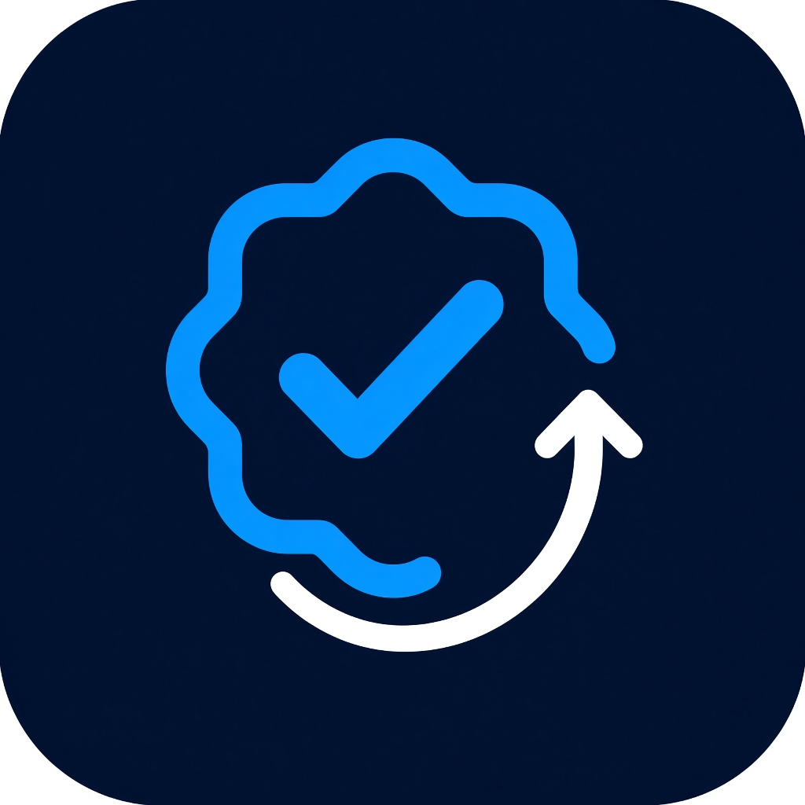

<p align="center">
  
</p>

<h1 align="center">蓝V回关检查 / Blue V non-followers</h1>

<p align="center">
  <a href="#中文">中文</a> · <a href="#english">English</a>
</p>

---

# 中文

看你在 X（Twitter）上还没回关你的蓝 V：实时，或超过 3 天 / 5 天 / 7 天。

<p>
  <b><font color="#ff0000">不建议使用「实时」。别人回关也需要时间，刚关注就检查，很容易把还来不及回关的人算进去。请优先使用超过 3 天、5 天或 7 天。</font></b>
</p>

你**不需要会 GitHub**，也不需要会写代码。  
只要会用 Chrome 或 Edge，按下面一步一步做就行。

这个插件只在你自己的电脑上、读取你已经打开的「正在关注」列表。  
**不会把你的账号密码发到任何服务器。**

## 1. 先下载到电脑（不会 GitHub 也没关系）

### 方法 A：直接点这个链接下载（最简单）

1. 用电脑打开这个下载地址：  
   **https://github.com/JiahaoJahao/x-blue-back/archive/refs/heads/master.zip**
2. 浏览器一般会把一个叫 `x-blue-back-master.zip` 的压缩包存到「下载」文件夹。
3. 如果浏览器问「是否保留」，选 **保留**。

### 方法 B：从 GitHub 页面下载

1. 打开这个网址：https://github.com/JiahaoJahao/x-blue-back
2. 页面上会看到绿色按钮 **Code**（有的界面写成 **代码**）。点它。
3. 在弹出来的菜单里，点 **Download ZIP**（下载 ZIP）。
4. 等下载完成。

> 不用点 Fork，不用点 Star，不用注册 GitHub 账号。  
> 也不要去用黑色命令行。

## 2. 解压压缩包

1. 打开电脑的「下载」文件夹，找到 `x-blue-back-master.zip`。
2. 右键这个文件，选 **解压全部** / **Extract All**。  
   没有这项的话，可以用 7-Zip、WinRAR，选「解压到当前文件夹」。
3. 解压后会得到一个文件夹，名字通常是 **`x-blue-back-master`**。
4. 打开这个文件夹。你应该能看到这些文件：
   - `manifest.json`
   - `popup.html`
   - `content.js`
   - `icons` 文件夹
5. 记住这个文件夹的位置。后面装插件时，要选**这一层**（能直接看到 `manifest.json` 的那一层）。  
   不要只选里面的 `icons` 或 `docs`。

建议把整个 `x-blue-back-master` 文件夹移到一个不容易删掉的地方，比如：

`D:\工具\x-blue-back-master`

以后不要随便删这个文件夹。插件是从这里读取的，删了插件就坏了。

## 3. 装到 Chrome

1. 打开 Chrome。
2. 点地址栏，输入下面这一行，回车：

   `chrome://extensions`

3. 右上角找到 **开发者模式**（Developer mode），把它打开。开关打开后一般会变成蓝色。
4. 左上角会出现 **加载已解压的扩展程序**（Load unpacked）。点它。
5. 在弹出来的窗口里，选中刚才解压出来的 **`x-blue-back-master`** 文件夹。  
   确认里面能看到 `manifest.json`，然后点 **选择文件夹**。
6. 列表里应该出现 **蓝V回关检查**。左边开关要是打开的。

### 把图标固定到浏览器右上角

1. 点 Chrome 右上角的拼图图标（扩展程序）。
2. 找到 **蓝V回关检查**，点旁边的图钉，让它亮起来。
3. 之后工具栏就能直接看到蓝 V 勾选图标。

## 4. 装到 Edge（微软浏览器）

1. 打开 Edge。
2. 地址栏输入下面这一行，回车：

   `edge://extensions`

3. 左下角打开 **开发人员模式**。
4. 点 **加载解压缩的扩展**。
5. 选中解压后的 **`x-blue-back-master`** 文件夹（能看到 `manifest.json` 的那一层）。
6. 点 Edge 右上角的拼图图标，把 **蓝V回关检查** 固定出来。

## 5. 怎么用

1. 先打开并登录 [x.com](https://x.com)。没登录的话，插件找不到你的关注列表。
2. 确认当前这个标签页就是 X，不要跑到别的网站再点开始。
3. 点浏览器右上角的插件图标。
4. 需要的话，先选语言，再选要看的是：
   - **超过 3 天**（建议）
   - **超过 5 天**（建议）
   - **超过 7 天**（建议）
   - **实时**（会列出当前所有未回关的蓝 V）
5. 点 **开始检查**。
6. 插件会先刷新当前 X 页面，再打开你的「正在关注 / Following」，并自动往下滚。
7. **请停在这个标签页**，不要切走，不要关。关注很多时，可能要滚几分钟。
8. 滚完后，右上角面板会列出对应范围里、对方还没回关的蓝 V。
9. 面板上方可以随时切换实时 / 超过 3 天 / 5 天 / 7 天。
10. 可以点 **复制** 把名单拷出来。每个人旁边有 **取关**，点谁才取关谁。

<p>
  <b><font color="#ff0000">再次提醒：不建议使用「实时」。别人回关也需要时间。刚关注就按实时名单取关，很容易误伤。</font></b>
</p>

如果点取关时提示「页面上暂时看不到」这个人：先在关注列表里用手往下滚，滚到能看见他，再点取关。  
X 的列表是「虚拟滚动」，滚走了，页面上就没有那一行。

## 6. 它具体看什么

- 只看带蓝 V（X Premium）的账号
- 看对方有没有「关注了你 / Follows you」
- 算出你关注这个人几天了
- 可看 **实时** 全部未回关蓝 V，或只看 **超过 3 / 5 / 7 天还没回关** 的蓝 V

金 V、灰 V（企业 / 政府）会尽量排除。

关注天数优先来自 X 关注列表自己的时间。如果这次读不到，插件会记下第一次扫到这个人的时间，下次再扫就能按天数筛。

## 7. 常见问题

**下载后是一个 `.zip`，打不开？**  
先解压。不要直接把压缩包拿去给浏览器装。必须先解压成文件夹。

**装插件时选不到，或装上后是坏的？**  
你选的文件夹不对。要选能直接看到 `manifest.json` 的那一层，一般叫 `x-blue-back-master`。

**点了开始没反应？**  
先确认已经登录 x.com，并且当前标签页就是 X。然后到 `chrome://extensions` 看插件开关是不是开着。还不行就刷新 X 页面再试。

**工具栏找不到图标？**  
点浏览器右上角拼图图标，把「蓝V回关检查」固定出来。

**名单是空的？**  
可能这些人关注都还没超过你选的天数，或者对方已经回关了。可以先换成「超过 3 天」再看。

**改过文件，或重新下载了一份新的？**  
到 `chrome://extensions`（Edge 是 `edge://extensions`），找到这个插件，点 **重新加载**。然后关掉旧的 X 标签，重新打开再检查。

**以后 GitHub 更新了，我怎么更新？**  
再按第 1 步下载一次新的压缩包，解压后覆盖原来的文件夹。然后到扩展程序页面点 **重新加载**。  
不要删掉正在用的文件夹再去装，容易找不到原来的位置。

## 8. 使用前请知道

- 这是给你自己用的本地扩展，**不适合上架 Chrome 应用商店**。自动滚列表、代点取关可能违反 X 条款，也可能被商店拒审。
- **没有一键全部取关。** 一次自动取关很多人，账号容易被限流。
- 关注特别多时，扫描会比较久，请耐心等它滚完。
- X 改版后，页面结构变了可能扫不全。刷新页面再试一次。
- 不要把 X 密码交给任何第三方网站。

## 9. 给会改代码的人

```
manifest.json
popup.html / popup.js / popup.css
content.js
page-hook.js
i18n.js
icons/
docs/icon.jpg
docs/social.jpg
```

改完代码后，到 `chrome://extensions` 点该扩展的 **重新加载**，然后关掉 X 标签再打开。

---

# English

Find blue-check accounts on X (Twitter) that do not follow you back: **Live**, or after **more than 3 / 5 / 7 days**.

<p>
  <b><font color="#ff0000">Live is not recommended. People need time to follow back. If you check right after following someone, they can look like they ignored you. Prefer more than 3, 5, or 7 days.</font></b>
</p>

You do **not** need a GitHub account, and you do **not** need to write code.  
If you can use Chrome or Edge, follow the steps below.

This extension only reads the Following list on your own computer.  
**It does not send your password to any server.**

## 1. Download it (no GitHub knowledge needed)

### Option A: Use this link (easiest)

1. Open this download link on your computer:  
   **https://github.com/JiahaoJahao/x-blue-back/archive/refs/heads/master.zip**
2. Your browser should save a file named `x-blue-back-master.zip` in your Downloads folder.
3. If the browser asks whether to keep it, choose **Keep**.

### Option B: Download from the GitHub page

1. Open https://github.com/JiahaoJahao/x-blue-back
2. Click the green **Code** button.
3. Click **Download ZIP**.
4. Wait until the download finishes.

> You do not need to Fork, Star, or create a GitHub account.  
> Do not use the black terminal / command line.

## 2. Unzip the file

1. Open your Downloads folder and find `x-blue-back-master.zip`.
2. Right-click it and choose **Extract All**.  
   If you do not see that, use 7-Zip or WinRAR and extract it here.
3. You should get a folder named **`x-blue-back-master`**.
4. Open that folder. You should see:
   - `manifest.json`
   - `popup.html`
   - `content.js`
   - an `icons` folder
5. Remember this folder. When you install the extension, select **this level** — the folder that directly contains `manifest.json`.  
   Do not select only `icons` or `docs`.

Move `x-blue-back-master` somewhere you will not delete by accident, for example:

`D:\Tools\x-blue-back-master`

Do not delete this folder later. The extension loads from it. If you delete it, the extension breaks.

## 3. Install in Chrome

1. Open Chrome.
2. Click the address bar, type this, and press Enter:

   `chrome://extensions`

3. Turn on **Developer mode** in the top-right. The switch usually turns blue.
4. Click **Load unpacked**.
5. Select the unzipped **`x-blue-back-master`** folder.  
   Make sure you can see `manifest.json`, then click **Select Folder**.
6. **Blue V non-followers** / **蓝V回关检查** should appear. Leave its switch on.

### Pin the icon

1. Click the puzzle-piece icon in the top-right of Chrome.
2. Find **蓝V回关检查** and click the pin.
3. The blue-check icon should stay on the toolbar.

## 4. Install in Edge

1. Open Edge.
2. Type this in the address bar and press Enter:

   `edge://extensions`

3. Turn on **Developer mode**.
4. Click **Load unpacked**.
5. Select the unzipped **`x-blue-back-master`** folder (the one that contains `manifest.json`).
6. Click the puzzle-piece icon in Edge and pin **蓝V回关检查**.

## 5. How to use it

1. Open and sign in to [x.com](https://x.com). If you are not signed in, the extension cannot see your Following list.
2. Stay on an X tab. Do not start from another website.
3. Click the extension icon in the top-right.
4. Choose a language if you want, then choose what to view:
   - **Over 3 days** (recommended)
   - **Over 5 days** (recommended)
   - **Over 7 days** (recommended)
   - **Live** (every blue check that is not following you back right now)
5. Click **Start scan**.
6. It will refresh the current X tab, open **Following**, and scroll down by itself.
7. **Stay on that tab.** Do not switch away or close it. A large Following list can take a few minutes.
8. When it finishes, the panel in the top-right lists blue checks in the range you chose that still have not followed you back.
9. You can switch Live / over 3 / 5 / 7 days in the panel at any time.
10. Use **Copy** to copy the list. Each person has **Unfollow**. It only unfollows the one you click.

<p>
  <b><font color="#ff0000">Again: Live is not recommended. People need time to follow back. Unfollowing from the live list right after you followed someone is easy to get wrong.</font></b>
</p>

If Unfollow says that person is not on the page: scroll the Following list until you can see them, then try again.  
X uses virtual scrolling. If a row has scrolled off screen, it is no longer in the page.

## 6. What it looks for

- Blue-check / X Premium accounts only
- Whether they have a **Follows you** badge
- How many days you have been following them
- Either **Live** (all current non-followers) or only those with **more than 3 / 5 / 7 days** and no follow-back

Gold and gray checks (business / government) are skipped when possible.

Follow days come first from X’s Following list timing. If that cannot be read this time, the extension remembers the first time it saw that account, and later scans can filter by days.

## 7. Common problems

**I downloaded a `.zip` and nothing happens?**  
Unzip it first. Do not load the zip file into the browser. Load the unzipped folder.

**Load unpacked fails, or the extension looks broken?**  
You selected the wrong folder. Select the folder that directly contains `manifest.json`. It is usually named `x-blue-back-master`.

**I clicked Start and nothing happens?**  
Make sure you are signed in on x.com, and that the current tab is X. Then open `chrome://extensions` and check that the extension switch is on. If it still fails, refresh the X tab and try again.

**I cannot find the icon?**  
Click the puzzle-piece icon in the top-right and pin **蓝V回关检查**.

**The list is empty?**  
Those accounts may not have passed the day range you chose, or they already follow you back. Try **Over 3 days**.

**I changed files or downloaded a new copy?**  
Open `chrome://extensions` (or `edge://extensions`), find this extension, and click **Reload**. Then close the old X tab and open a new one.

**How do I update later?**  
Download the zip again from step 1, unzip it, and replace the old folder. Then click **Reload** on the extensions page.  
Do not delete the folder you are using before you know where the new one is.

## 8. Please read this first

- This is a local extension for your own use. **It is not meant for the Chrome Web Store.** Auto-scrolling and clicking Unfollow may break X’s rules, and a store listing could be rejected.
- **There is no unfollow-all button.** Unfollowing many accounts at once can get your account limited.
- A large Following list takes longer. Let it finish scrolling.
- If X changes its page layout, the scan may miss people. Refresh and try again.
- Do not give your X password to any third-party website.

## 9. For people who edit the code

```
manifest.json
popup.html / popup.js / popup.css
content.js
page-hook.js
i18n.js
icons/
docs/icon.jpg
docs/social.jpg
```

After you change the code, click **Reload** on `chrome://extensions`, then close the X tab and open it again.
